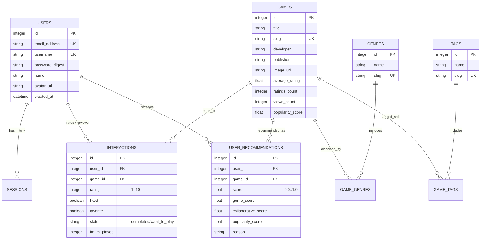
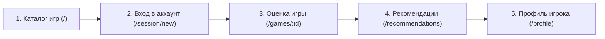

# Руководство по защите этапа: Модели, Схема БД, Автотесты и Happy Path

> **Проект:** GamePulse (Рекомендательная система видеоигр)  
> **Стек:** Ruby 3.4 / Rails 8.0 / SQLite 3 / Minitest / Tailwind CSS v4  
> **Ветка в Git:** `feature`  
> **Запуск тестов:** `ruby bin/rails test` (44 теста, 0 ошибок)  
> **Адрес запущенного сайта:** [http://localhost:3000](http://localhost:3000)  

---

## 1. Схема базы данных (Database Schema)

Проект спроектирован в **Третьей Нормальной Форме (3NF)** с использованием внешних ключей (`foreign keys`) и уникальных составных индексов для целостности данных.

### Визуальная ER-диаграмма связей



### Назначение таблиц для преподавателя:
1. **`users`** — аккаунты пользователей, безопасное хранение паролей через `has_secure_password` (bcrypt с солью), нормализация email и логинов.
2. **`games`** — каталог игр со Steam-обложками (460x215), денормализованными агрегатами (`average_rating`, `ratings_count`, `popularity_score`) для быстрого чтения без тяжелых агрегирующих SQL-запросов.
3. **`genres` / `tags`** — словари жанров и тегов.
4. **`game_genres` / `game_tags`** — соединительные таблицы для связей Many-to-Many с уникальными составными индексами (`unique: true`), исключающими дублирование.
5. **`interactions`** — действия пользователя: оценка (1–10), лайк, статус («Прошёл», «Хочу пройти»). Имеет уникальный индекс `[user_id, game_id]`, гарантирующий, что один пользователь не может поставить две оценки одной игре.
6. **`user_recommendations`** — кэш персонализированной выдачи с разбивкой скоров (Genre Score, Collab Score, Popularity) и объяснением причины рекомендации.

---

## 2. Модели: Валидации, Ассоциации и Бизнес-логика

В приложении логика не размазана по контроллерам, а сосредоточена в моделях (паттерн **Fat Model, Skinny Controller**):

| Модель | Ассоциации | Валидации | Методы бизнес-логики |
|---|---|---|---|
| **`Game`** | `has_many :game_genres`<br>`has_many :genres`<br>`has_many :interactions`<br>`has_many :users` | `presence :title`<br>`uniqueness :slug` | • **`update_metrics!`**: расчет взвешенного рейтинга и популярности<br>• **`similar_games(limit)`**: поиск игр с похожими жанрами/тегами<br>• **`to_param`**: ЧПУ-ссылки по slug вместо id |
| **`User`** | `has_many :sessions`<br>`has_many :interactions`<br>`has_many :user_recommendations` | `uniqueness :email_address`<br>`format :username`<br>`length :password` | • **`favorite_genres`**: выборка любимых жанров игрока по оценкам $\ge 7$<br>• **`interaction_for(game)`**: поиск оценки для конкретной игры<br>• **`display_name`**: красивое отображение имени/логина |
| **`Interaction`** | `belongs_to :user`<br>`belongs_to :game` | `uniqueness :user_id (scope: :game_id)`<br>`numericality :rating (1..10)`<br>`inclusion :status` | • **`refresh_metrics_and_recommendations`**: колбэки `after_save` и `after_destroy`, которые сразу обновляют метрики игры и ставят в фоновую очередь задачу пересчета рекомендаций |
| **`RecommendationEngine`** | Сервисный объект бизнес-логики | Проверка на холодный старт | • **`calculate!`**: расчет гибридного скора: $0.4 \times Genre + 0.3 \times Collab + 0.2 \times Pop + 0.1 \times Recency$<br>• **`build_explanation`**: генерация человекочитаемой причины рекомендации |

---

## 3. Автотесты на методы бизнес-логики

В соответствии с требованием задания в проекте создано **4 файла тестов моделей** с разделением на независимые контексты:

| Файл теста | Проверяемые контексты бизнес-логики |
|---|---|
| **`test/models/game_test.rb`** | 1. **Контекст `update_metrics!`**: точный расчет среднего балла и скора популярности при нескольких оценках, а также обработка игр с 0 оценок.<br>2. **Контекст `similar_games`**: поиск тайтлов с пересекающимися жанрами и тегами с исключением самой себя.<br>3. **Контекст валидаций и скоупов**: генерация slug, скоупы `popular`, `top_rated`, `recent`. |
| **`test/models/interaction_test.rb`** | 1. **Контекст колбэков**: автоматический вызов пересчета метрик игры и постановка задачи `RecommendationJob` в очередь.<br>2. **Контекст валидаций**: жесткое ограничение оценки 1..10, уникальность пары (user + game), допустимые статусы. |
| **`test/models/user_test.rb`** | 1. **Контекст вкусов пользователя**: работа метода `favorite_genres` (учитывает только оценки $\ge 7$) и `interaction_for`.<br>2. **Контекст профиля**: `display_name` и `avatar_image_url`.<br>3. **Контекст безопасности**: нормализация email/логина (downcase, strip), валидация регулярным выражением. |
| **`test/models/recommendation_engine_test.rb`** | 1. **Контекст персонализации**: выдача рекомендаций на основе похожих пользователей и совпадения жанров.<br>2. **Контекст очередей**: асинхронный расчет фоновой задачей.<br>3. **Контекст Cold Start**: выдача качественных хитов для нового пользователя с 0 оценок. |

### Как продемонстрировать тесты преподавателю в терминале:
```bash
ruby bin/rails test test/models
```
*Результат:* **19 runs, 67 assertions, 0 failures, 0 errors** (все тесты зеленые).

Либо запуск полного набора из 44 тестов (включая контроллеры и UI):
```bash
ruby bin/rails test
```

---

## 4. Happy Path пользователя (Пошаговый сценарий демонстрации)

По требованию задания пользователь должен иметь возможность «прокликать весь кор-функционал от начала до конца».

### Сценарий показа за 3 минуты:



1. **Шаг 1: Просмотр каталога (Гостевой режим)**
   * Откройте главную страницу: [http://localhost:3000](http://localhost:3000).
   * Покажите поиск по названию и кликните на фильтр любого жанра (например, *«RPG»*).
   * Кликните на вкладку *«Рекомендованные»* — система вежливо сообщает, что для персонального подбора нужно войти в аккаунт.

2. **Шаг 2: Авторизация в 1 клик**
   * Нажмите кнопку *«Войти»* в шапке или перейдите на [http://localhost:3000/session/new](http://localhost:3000/session/new).
   * Нажмите на кнопку быстрого демо-входа: **«Войти как Alex (RPG фанат)»** (пароль подставится автоматически).

3. **Шаг 3: Выставление оценки игре (Кор-действие)**
   * Перейдите в карточку любой игры, например *The Witcher 3* или *Elden Ring*.
   * На панели справа выберите балл на шкале **1–10** (например, **10**), поставьте галочку **«Прошёл»** и нажмите **«Сохранить оценку»**.
   * Покажите преподавателю: метрики игры мгновенно обновились, а в базе сработал колбэк пересчета рекомендаций.

4. **Шаг 4: Персональные рекомендации с объяснением**
   * Перейдите во вкладку **«Рекомендации»** ([http://localhost:3000/recommendations](http://localhost:3000/recommendations)).
   * Покажите карточки с **Match Score (процент совпадения)**, полосы схожести жанров/тегов и блок *«Почему рекомендовано»*.

5. **Шаг 5: Профиль пользователя**
   * Нажмите на имя пользователя в правом верхнем углу $\rightarrow$ откроется [http://localhost:3000/profile](http://localhost:3000/profile).
   * Продемонстрируйте статистику: число оцененных игр, средний балл, любимый жанр и список всех оцененных тайтлов.

---

## 5. Шпаргалка: Как отвечать на каверзные вопросы преподавателя

* **В: «Почему логика подсчета рейтинга игры вынесена в `Game#update_metrics!`, а не считается динамически в запросе?»**  
  *О: «Динамический `SELECT AVG(rating)` при каждом открытии каталога из 100 игр создавал бы лишнюю нагрузку на БД. Денормализация этих полей в таблицу `games` позволяет отдавать каталог за константное время $O(1)$, а обновление вызывается только по событию сохранения оценки через колбэк в модели `Interaction`.»*

* **В: «Как решается коллизия, если пользователь попытается дважды оценить одну игру?»**  
  *О: «Защита на двух уровнях: на уровне Rails-модели валидацией `validates :user_id, uniqueness: { scope: :game_id }`, и на уровне базы данных уникальным составным индексом `add_index :interactions, [:user_id, :game_id], unique: true`.»*

* **В: «Что тестируют ваши тесты в `test/models/`?»**  
  *О: «Они тестируют критическую бизнес-логику: корректность математических формул рейтинга и популярности, поиск похожих игр, алгоритм гибридных рекомендаций и холодного старта, а также целостность данных и валидации.»*
